


 

## Stack


## Proyectos destacados

  <a href="https://github.com/Md0609/Minishell"></a>
  <a href="https://github.com/Md0609/Philo"></a>
  <a href="https://github.com/Md0609/Stratum-Sort"></a>
  <a href="https://github.com/Md0609/get_next_line"></a>

<b>Currículo de 42 Madrid (click para desplegar)</b>

 

  <a href="https://github.com/Md0609/libft"></a>
  <a href="https://github.com/Md0609/ft_printf"></a>
  
  <a href="https://github.com/Md0609/Push_swap"></a>
  <a href="https://github.com/Md0609/Pipex"></a>
  
  

## Actividad


